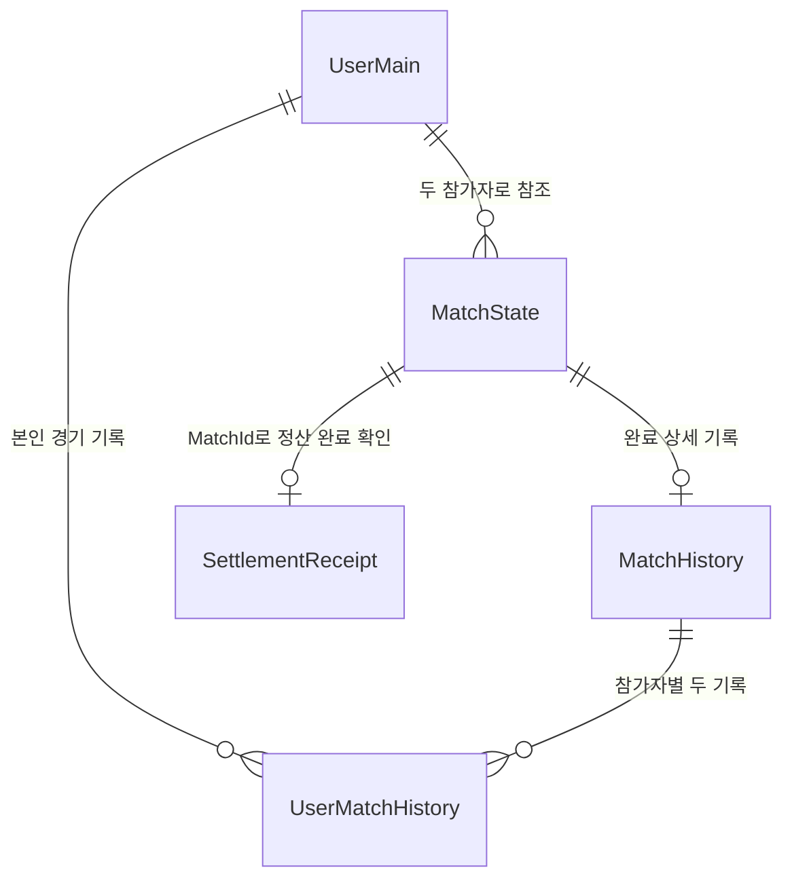

# 대전 경기 결과 저장·정산 단계별 작업 문서

2026-10-08 실행 상태는 [작업 진행 기록](MatchResultProgress.ko.md)을 참고한다. 8단계 전체 진행 요청을 받았으며 현재는 1단계 설치·로그인 선행 조건을 해결하는 중이다.

작성 기준: 2026-10-07. 방향은 **뒤끝 펑션 사용**이다. 다만 펑션 활성화와 안전한 정산 가능 여부는 별개이므로, 실서버 검증을 통과한 다음 운영 정산을 연결한다. 현재 HTTP 400은 미배포·인증키 미설정 상태에서 나온 결과이며 펑션 서비스 자체의 장애나 정산 가능 여부를 판정한 결과가 아니다.

## 1. 현재 완료된 작업과 남은 작업

| 구분 | 현재 상태 |
| --- | --- |
| 4구·3구 전적 | UserMain의 Ball_4_Win/Lose/Draw, Ball_3_Win/Lose/Draw 및 클라이언트 읽기·초기화 구현 |
| 경기 기록 | MatchHistory, UserMatchHistory 구성 및 클라이언트 보고 저장·재시도 구현 |
| 정산 규칙 | 서버용 시작 차감, 승리 지급, 무승부 반환, 기권·연결 만료, 중복 방지 로직 구현 |
| 로컬 검사 | 정산 규칙 28개와 펑션 진입·진단 관련 10개, 총 38개 통과. 검사용 메모리 저장소 기준 |
| 펑션 | 서비스 활성화. 진단 소스와 Unity 검증 창 준비. 콘솔 등록 함수 0개 |
| 실제 호출 | Come에서 user02 로그인 → Consist에서 Health/Seed: 400 / BadRequestException |
| 운영 정산 | 영구 저장소·권한·동시성 검증, 정산 함수 배포, 게임 호출 연결 미완료 |

현재 기록 저장은 참가자의 보고이며 서버 정산 완료를 의미하지 않는다. 실제 경기에서 이 서버 정산 코드를 통한 입장료 차감·보상 지급은 아직 실행되지 않는다.

## 2. 확정한 게임 규칙

- 4구와 3구는 각각 승·패·무승부를 관리한다. 승률 표시의 제안 기준은 해당 종목의 Win / (Win + Lose + Draw), 0경기는 0%다. 무승부를 분모에서 제외할지는 화면 연결 전에 확정한다.
- 양쪽 준비 승인이 끝나고 서버가 시작을 확정할 때 각자의 입장료를 한 번 차감한다. 서버 승인 전에는 경기를 진행하지 않는다.
- 승자에게 양쪽 입장료 합계를 지급한다. 무승부는 각자의 입장료를 반환한다.
- 시작 전 취소는 차감하지 않는다. 시작 후 양쪽이 모두 연결 만료되면 반환하고 전적은 증가시키지 않는다.
- 시작 후 명시적 나가기는 본인 기권 패배로 처리한다. 연결 끊김은 즉시 패배로 처리하지 않고 복귀 유예를 둔다.
- 방장은 경기 시작 요청을 담당할 수 있다. 남은 참가자는 상대 연결 만료 평가를 요청할 수 있다. 실제 잔액·전적 변경과 승패 확정은 펑션이 수행한다.

## 3. 데이터 역할과 관계

MatchState와 SettlementReceipt는 **운영 저장소 연결 시 추가할 논리 구성**이다. 뒤끝에 이미 만들어진 테이블이라는 뜻은 아니다. 개인 기록의 권한과 서버에서 양쪽 행을 갱신할 수 있는 경로는 5단계 검증 후 확정한다.

| 데이터 | 보관할 내용 | 보관 기준 |
| --- | --- | --- |
| UserMain | Coin, 종목별 Win/Lose/Draw | 누적 유지 |
| MatchState — 추가 예정 | 고유 MatchId, 참가자 A/B, Ball, 경기장, 검증된 입장료·규칙, 상태, 준비 승인, 시작 시각, 각자 마지막 생존 신호, 결과 보고·충돌 여부 | 진행·복구에 필요. 종료 데이터의 정리 정책은 원장 연결 후 결정 |
| SettlementReceipt — 추가 예정 | 고유 MatchId, 참가자, Ball, 결과·사유, 각자 차감·지급액, 정산 시각 | 상세 기록 삭제 후에도 재지급 방지를 위해 유지 |
| MatchHistory | 경기 단위 점수·승자·시간·종목·정산 상태·HistoryExpiresAt | 정산 완료 후 6개월 상세 기록 |
| UserMatchHistory | 본인·상대·결과·종목·점수·차감·지급·정산 상태·HistoryExpiresAt | 정산 완료 후 6개월 상세 기록 |

기존 Win/Lose는 보존한다. 종목을 구분할 근거가 없는 과거 합산값을 임의로 4구·3구에 나누지 않는다. 기존 프로필 저장에서 Coin과 여섯 전적 필드를 제외한 처리는 유지한다. 별도로 서버 쓰기 권한도 제한해야 한다.

## 4. 단계 A — 펑션 배포·호출 확인

목표: 정산 기능에 앞서 실제 로그인 계정에서 진단 펑션을 호출할 수 있는지 확인한다.

1. 공식 배포 도구를 준비하고 현재 프로젝트에 진단 함수 MatchSettlementProbe를 배포한다.
2. 테스트 계정만 허용하도록 ProbeSettings를 설정한다. 인증키는 저장소·로그에 노출하지 않고 클라이언트 실행 설정에 연결한다.
3. Unity 메뉴 `Tools → Magic Online → Backend Function Probe → Run from Arise`로 실행한다.
4. Arise → Come에서 테스트 계정 로그인 → Consist 검증 창의 `2 Health`를 누른다.

완료 기준: HTTP 호출 성공뿐 아니라 함수 응답 본문의 정상 여부를 확인한다. Health의 storage/settlement 비활성 표시는 현재 미연결 상태를 알리는 정상 진단 응답이며 정산 성공을 뜻하지 않는다.

## 5. 단계 B — 실제 저장·권한·동시성 검증

기존 베이스 게임 정보의 전용 테스트 테이블 FunctionProbePublic/FunctionProbePrivate와 두 테스트 계정을 사용한다. 실제 사용자 Coin·전적을 변경하지 않는다.

| 검사 | 화면 버튼 | 통과 시 확인할 데이터 |
| --- | --- | --- |
| 본인 데이터 생성 | Generate Run ID → Seed → Read self | Primary/Audit의 Counter=0, Version=0 |
| 본인 수정 | Write self → Read self | Counter=1, Version=1 |
| 두 계정 갱신 | 각 계정 Seed, 상대 정보 입력 → Read peer → Write pair → 양쪽 Read self | 양쪽 값이 함께 증가 |
| Private 권한 | Private 체크 후 새 RunId로 같은 순서 | 허용 범위·거부 단계 명확히 기록 |
| 부분 실패 | Rollback | 실패 응답, 두 행의 이전·이후 값 동일 |
| 같은 요청 경쟁 | 새 RunId, Concurrent requests → Read self | 승인 정확히 1개, Counter=1, Version=1 |
| 재전송 | Retry old version → Read self | 재승인 없음, 값 유지 |

이 결과는 특정 테스트의 관찰이다. 다른 경기에서 같은 사용자에 대한 동시 갱신, 고유 MatchId 생성, 권한 제한, 응답 손실 복구까지 확인해야 운영 정산을 승인할 수 있다. 단순 조회 후 쓰기나 펑션 내부 lock으로 중복 방지를 해결했다고 판단하지 않는다.

**진행 조건:** 기존 뒤끝 저장소로 양쪽 잔액·전적·경기 상태·원장을 안전하게 처리할 수 있는지 확인한다. 지원 범위가 부족하면 이 단계에서 저장 구조 또는 지원 API 경로를 재설계한다. 추가 서버가 없는 현재 환경에서 펑션만 활성화했다고 이 조건이 자동 충족되는 것은 아니다. 새 Database 서비스로의 이전은 현재 보류한다.

## 6. 단계 C — 운영 저장소와 서버 검증 연결

1. ISettlementStore를 영구 저장소에 연결한다. 현재 테스트용 메모리 구현은 사용하지 않는다.
2. 로그인에서 얻은 서버 인증 사용자만 명령을 실행하게 하고, 요청에 적힌 UserId를 권한 근거로 삼지 않는다.
3. 두 참가자의 동의, 경기장·종목, 차트에서 조회한 입장료와 규칙을 검증한다. 클라이언트 보고 행을 그대로 신뢰하지 않는다.
4. 두 사용자 Coin·전적, 경기 상태, 정산 원장, 개인 기록을 전체 성공 또는 전체 실패로 처리한다.
5. 같은 경기 재요청과 서로 다른 경기의 동일 사용자 갱신 경쟁을 모두 방지한다.

완료 기준: 실제 저장소에서 중복 지급·잔액 유실·일부 사용자만 갱신되는 문제가 없고, 실패 재시도로 복구 가능해야 한다.

## 7. 단계 D — 경기 시작 연결

흐름: 방장 등록 요청 → 서버 검증·Registered 저장 → A/B Ready 승인 → 양쪽 잔액 확인 → 입장료 차감과 Playing 저장 → 게임 시작.

경기 시작 기록은 필요하다. 종료 결과만 저장하면 누구와 어떤 입장료로 시작했는지, 이미 차감했는지, 연결 만료를 언제 판단할지 서버가 확인할 수 없다. 재전송은 같은 MatchId를 사용하고 이미 시작된 경기에 다시 차감하지 않는다. 기존 클라이언트 시작 보고·저장 대기는 서버 승인 흐름에 맞춰 조정한다.

## 8. 단계 E — 정상 종료와 결과 화면 연결

흐름: 양쪽 ConfirmResult → 서버가 점수·승자 보고 비교 → 일치하면 정산 → Applied 원장 저장 → 클라이언트가 확정 Coin·전적·개인 기록 새로 조회.

결과가 서로 다르면 Disputed로 보류하고 지급하지 않는다. 클라이언트 결과 창은 `정산 중 / 완료 / 확인 필요`를 구분한다. 응답을 못 받으면 같은 MatchId로 조회·재요청하고 로컬에서 지급을 추정하지 않는다.

4구 A 승리, 입장료 100, 시작 전 A/B Coin=1,000의 기대 예:

| 시점 | A Coin | B Coin | 전적·기록 |
| --- | --- | --- | --- |
| 시작 승인 | 900 | 900 | Playing, 시작 기록 |
| 정산 완료 | 1,100 | 900 | A Ball_4_Win +1, B Ball_4_Lose +1, 원장 1개, 경기 기록 1개, 개인 기록 2개 |
| 같은 결과 재요청 | 1,100 | 900 | 추가 증가 없음 |

3구라면 Ball_3 필드만 변경한다. 무승부는 각자 Coin=1,000으로 반환하고 해당 종목 Draw를 각각 1 증가시킨다. 이 표는 **배포 후 검증할 기대 결과**이며 현재 실서버에서 관찰한 결과가 아니다.

## 9. 단계 F — 나가기·연결 끊김·복귀

- 명시적 나가기: Surrender 요청을 받은 펑션이 참가자 여부·시작 상태를 검사하고 기권 정산한다.
- 갑작스러운 연결 끊김: 각자가 본인 Heartbeat를 보내고 서버 시각으로 LastSeen을 갱신한다. 상대의 생존 신호를 대신 갱신하지 못하게 한다.
- 현재 기본 기준: 생존 신호 15초 중단 + 복귀 유예 30초, 총 45초 경과. 상대는 최근 15초 이내 신호가 있어야 승리한다. 제품 정책에 따라 조정 가능한 값이다.
- 복귀가 허용 시간 안에 확인되면 계속 진행한다. 이미 Applied가 된 뒤 복귀한 경우 확정 결과를 조회한다.
- 양쪽 모두 만료되면 입장료 반환, 전적 증가 없음. 둘 다 오프라인이어도 처리할 예약 만료 평가 작업을 연결한다.

남은 사람은 EvaluateDisconnect를 요청한다. 끊긴 사람의 Coin을 직접 수정하지 않는다. Photon 연결 이벤트와 서버 생존 신호·시각 판정을 연결하고 결과 확정의 순서를 검증해야 한다.

## 10. 단계 G — 6개월 상세 기록 삭제

정산은 경기 직후 수행한다. 6개월 후 삭제 작업은 정산을 다시 실행하지 않는다.

1. 서버 정산 시각을 기준으로 HistoryExpiresAt을 6개월 뒤로 기록한다.
2. 예약 작업이 만료된 완료 상세 기록을 작은 묶음으로 삭제한다. 진행 중·정산 보류·실패 복구 대상은 제외한다.
3. MatchHistory와 두 UserMatchHistory를 정리하고, 중간 실패 후 재실행해도 정리할 수 있게 한다.
4. UserMain 누적 Coin·전적과 영구 SettlementReceipt는 유지한다.
5. 상세 기록 삭제 후 예전 결과 요청을 재전송해 추가 지급·전적 증가가 없는지 검사한다.

삭제 조건에 정산 상태가 필요한 이유는 미완료 복구 자료를 지우지 않기 위해서다. 정산 원장을 남기는 이유는 상세 기록이 없어져도 같은 경기의 재지급을 막기 위해서다.

## 11. 단계 H — 두 기기 최종 검증과 운영 적용

실제 두 계정·두 기기로 4구/3구 승리, 무승부, 명시적 나가기, 일시 끊김 후 복귀, 한쪽 만료, 양쪽 만료, 결과 불일치, 잔액 부족, 중복 요청, 저장 실패·재시도를 확인한다. 각 검사에 씬·버튼·MatchId·이전/이후 Coin·전적·행 개수·응답·시각을 기록한다.

운영 적용 조건: 저장소 안전 조건과 위 검사가 통과하고, 보류 경기 조회·재처리 및 오류 추적 경로가 준비돼야 한다. 진단 함수는 사용 중지하고 운영 정산 함수만 연결한다.

## 12. 바로 다음 작업

다음 순서는 **단계 A의 진단 펑션 배포·인증키 연결 → 단계 B의 실제 데이터 검사**다. 이 두 단계의 결과를 보고 운영 정산 연결 가능 여부를 판단한다.

관련 소스·문서:

- [펑션 실행·검사 상세](BackendFunctionProbe.ko.md)
- [서버 정산 규칙과 구현 상태](../Server/README.ko.md)
- [진단 펑션 진입점](../Server/BackendFunction/Function.cs)
- [저장소 계약](../Server/MatchSettlement/Contracts.cs)
- [정산 로직](../Server/MatchSettlement/SettlementService.cs)
